# Eagle | Media Preview Server

<p align="center">
  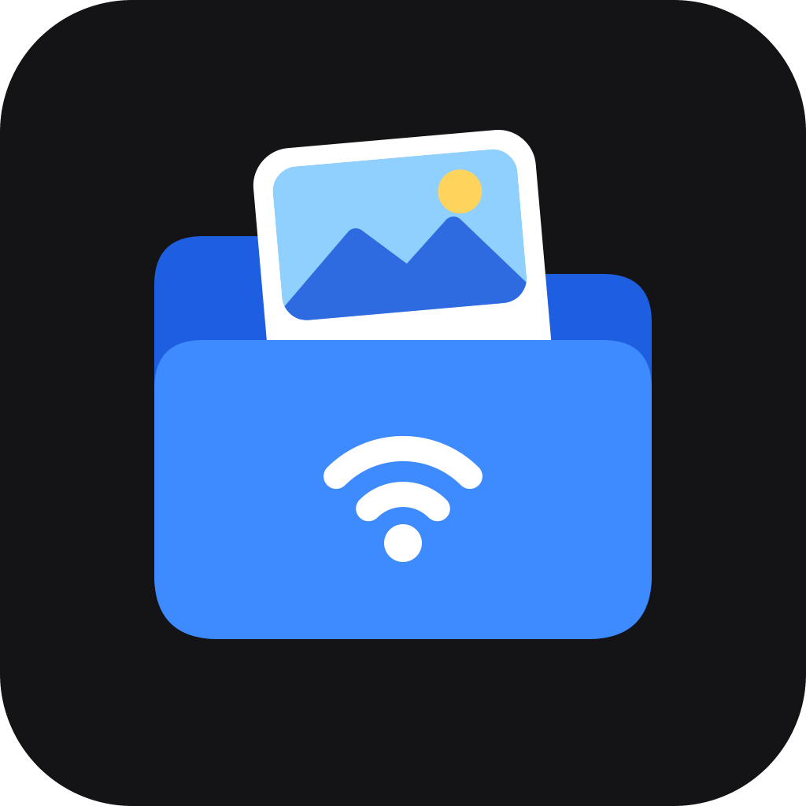
</p>

Media Preview Server is an Eagle plugin that shares your Eagle library (**Media Library**) on your local network with one click.
Anyone on the same network can then browse it from phones, tablets, and other computers.

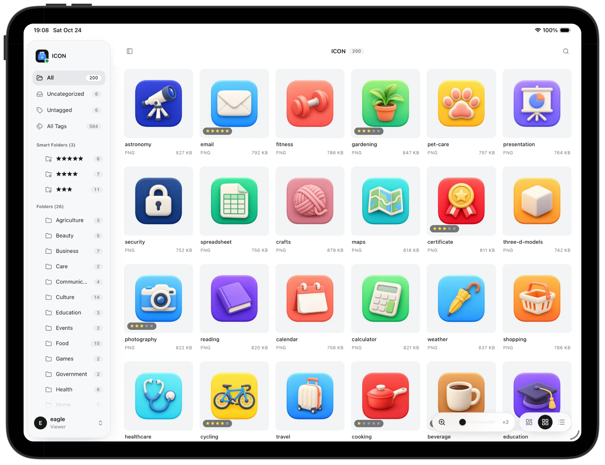
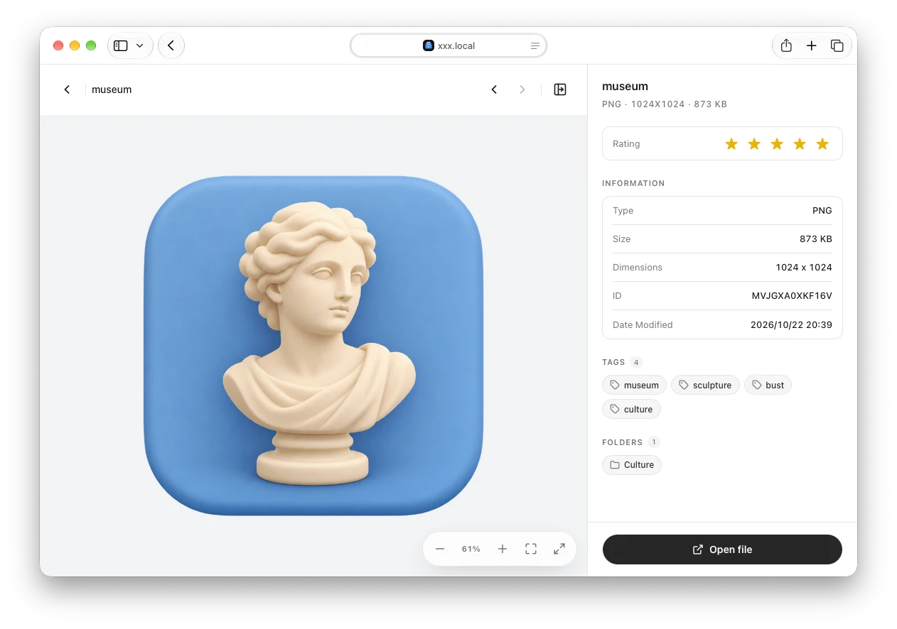
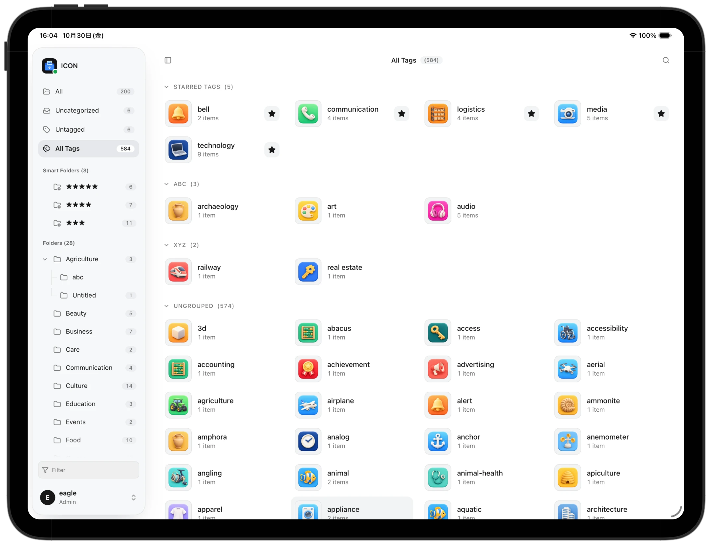
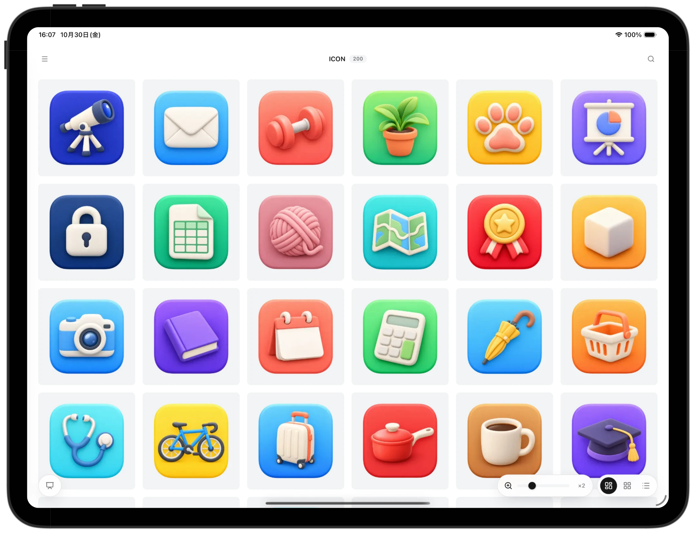
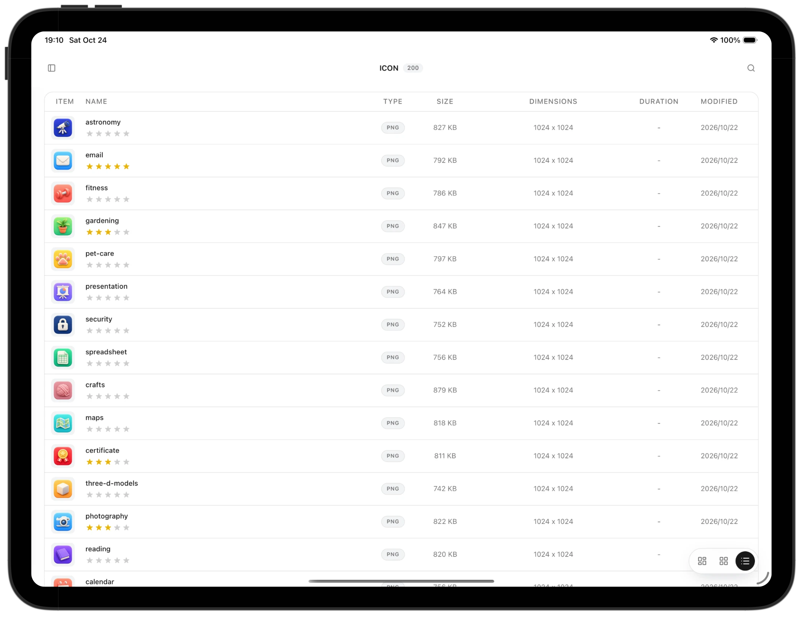

## Features

- One-click local preview server for your Eagle library
- Browse the Media Library from phones, tablets, and other computers on the same LAN
- Endpoint URL and QR code for quick access, with an optional custom hostname
- Installable PWA (**Media Library**) with a cached application shell
- Background audio and video playback shows the file name and thumbnail in the OS media controls
- Picture-in-Picture controls for video previews on supported desktop and mobile browsers, with automatic PiP in supported desktop Chrome versions

Optional:

- Auto start: start the server automatically when Eagle launches.
- Password protection: require a username and password to access the viewer.
- Public Network: allow access from other devices on the network.
- HTTPS: use TLS when certificate paths are set.
- Multiple users with Viewer, Editor, and Admin roles.
- Library protection: share only the Eagle libraries you select.

## Architecture

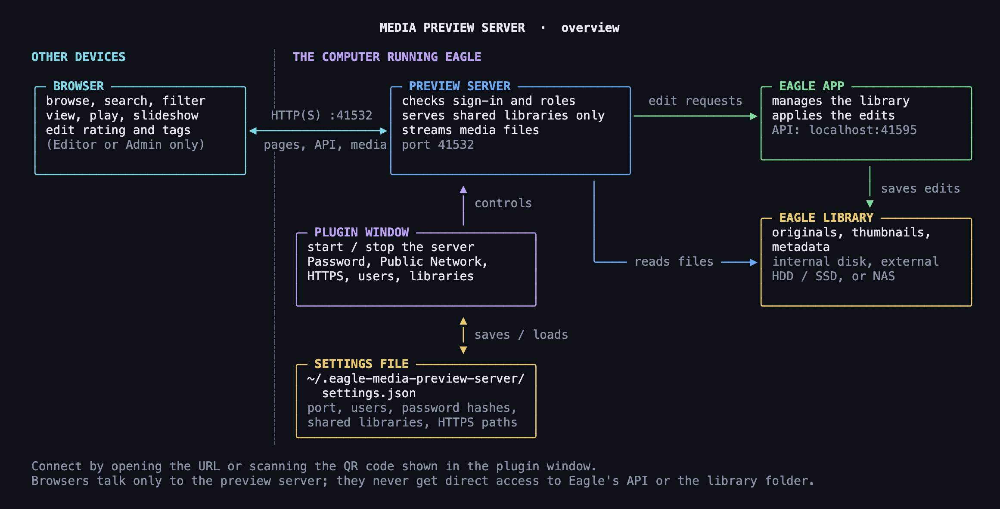

The preview server, plugin window, and settings file come from this plugin, not from Eagle itself; the plugin runs the server inside Eagle. Browsers on other devices talk only to that preview server. They never get direct access to Eagle's own API or the library folder.

For the detailed architecture, access control, and file protection, see [Runtime Model in EAGLE_PLUGIN_SPEC.md](docs/EAGLE_PLUGIN_SPEC.md#runtime-model).

## Future Plans

- Expand support for additional file extensions
- Add AI-related capabilities

### Limitations

These are planned, but on hold until the Eagle API supports them:

- Sort results by date, rating, name, or size
- Add or remove favorite tags
- Filter by multiple file extensions at once
- Use search filters inside smart folders

## PWA Installation

The browser viewer can be installed from a supported desktop or mobile browser. Service workers require a secure context, so use HTTPS when opening the viewer from another device on your LAN. Loopback addresses such as `localhost` are also treated as secure by browsers.

The PWA caches only the application shell. Eagle API responses and library media are intentionally excluded from the service-worker cache, so browsing library content still requires a connection to the running plugin server.

## Slideshow

Slideshows start muted on all devices. To hear video or audio, use the speaker button in the bottom playback bar to turn sound on during playback.

## Video Picture-in-Picture

Use the **Picture-in-Picture** button in video controls. It appears when the browser supports the loaded video. Closing the preview or switching items closes PiP.

- **Chrome automatic PiP:** Requires HTTPS, audible playback, and permission for the site. “Can ask” also depends on playback history. [Requirements](https://developer.chrome.com/blog/automatic-picture-in-picture-media-playback).
- **macOS Safari:** Enable **Video Viewer** from Safari's Page Menu for automatic PiP when switching tabs. [Details](https://webkit.org/blog/15865/webkit-features-in-safari-18-0/#viewer).
- **Mobile:** Support varies by browser and OS. If an installed web app lacks PiP, try opening the URL in Safari.

## Settings

### Server Status

Start or stop the server, copy the endpoint URL, or scan the QR code to open the viewer on your phone. The quick toggles below the URL control **Auto start**, **Password protection**, **Public Network**, and **HTTPS**.

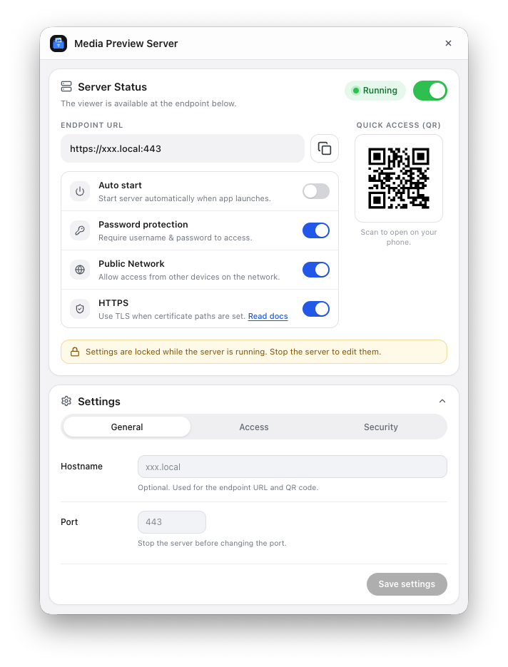

Settings are locked while the server is running. Stop the server to edit them.

### General

Hostname and port.

Set **Hostname** to a hostname such as `studio-mac.local`, `windows-pc.local`, or `media-server.lan` (without `http://`, a port, or a path). Stop the server, enter the hostname under **Settings → General**, and save. The endpoint URL, copy/open actions, and QR code use this hostname with the configured HTTP/HTTPS protocol and port. Clear the field to return to the automatic localhost/LAN IP URL.

The saved hostname is explicitly allowed for sign-in and writes; the request Origin must still match the protocol, host, and port. Other custom hostnames remain blocked. This setting does not register DNS or advertise mDNS: configure name resolution separately and enable **Public Network** to connect from other devices. For HTTPS, the certificate must cover the custom hostname and be trusted by each client.

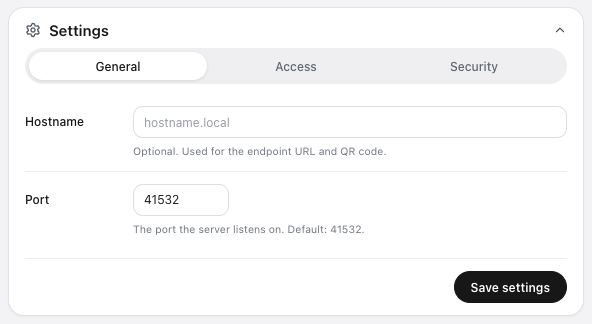

### Access

Users and sign-in session settings.

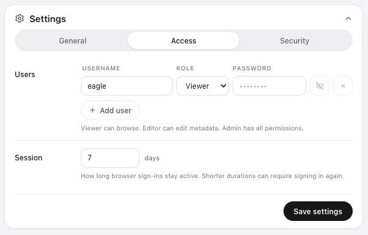

Use this tab to choose which users can sign in to the viewer. To let other devices on the LAN open the viewer, turn on **Public Network** in Server Status. User roles define the available actions:

- Viewer: browse and preview media
- Editor: edit rating, tags, and categories from the preview panel
- Admin: has all available permissions

Authentication is optional. When password protection is enabled, browser access uses the built-in login screen and cookie-based sessions. Sessions expire after the configured session duration, 7 days by default.

> [!IMPORTANT]
> Media is stored in the browser's normal cache and may be reused for up to one hour after it is fetched, without asking the server. Signing out or switching libraries does not immediately remove media that is already cached. On a shared device, use a private window.

### Libraries

Choose which Eagle libraries the viewer may serve.

Eagle can only have one library open, and the viewer serves whichever library that is. Turn on **Share only selected libraries**, check the libraries to share, and save. If you open a different library in Eagle, viewers see the "Media Library is offline" page as soon as the viewer opens, before signing in, until a shared library is open again. The list shows the library open in Eagle and Eagle's recent libraries; use **Reload libraries** to refresh it. Checked libraries are saved by path.

Like other settings, these are locked while the server is running and take effect when the server starts. Viewers can never switch the library open in Eagle.

### Security

HTTPS/TLS settings.

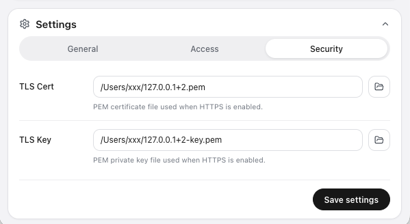

HTTPS protects the login password and session cookie on the network. For local/LAN use, `mkcert` is the recommended way to create a trusted development certificate.

See [HTTPS and mkcert CA Operations](docs/https-mkcert.md) for setup, plugin HTTPS settings, Windows/macOS/iOS/Android CA trust steps, and private-key cautions.

- `TLS Cert`: the certificate file
- `TLS Key`: the matching private key file

## Requirements

- Eagle 4.0 Build 23 or later
- Node.js 20 or later

## Development

```sh
npm install
npm run dev
```

`npm run dev` starts the Vite development server for the React UI.

## Build

```sh
npm run build
```

Build output is written to `dist`.

## Verification

```sh
npm run typecheck
npm run build
npm test
```

Run `npm run verify` before committing when you need the full TypeScript, Vite build, and Vitest check in one command.

## Details

See [EAGLE_PLUGIN_SPEC.md](docs/EAGLE_PLUGIN_SPEC.md) for plugin behavior, settings, server routes, authentication, and runtime details.

## Disclaimer

This plugin is intended for use on a local or trusted LAN, not for public internet access.

The displayed content depends on the Eagle library opened by the Eagle app running on the server side.

The author is not responsible for unintended access, data exposure, or any damage caused by misconfiguration, insecure network settings, weak passwords, disabled authentication, or public exposure of the server.
