# Eagle | Media Preview Server

  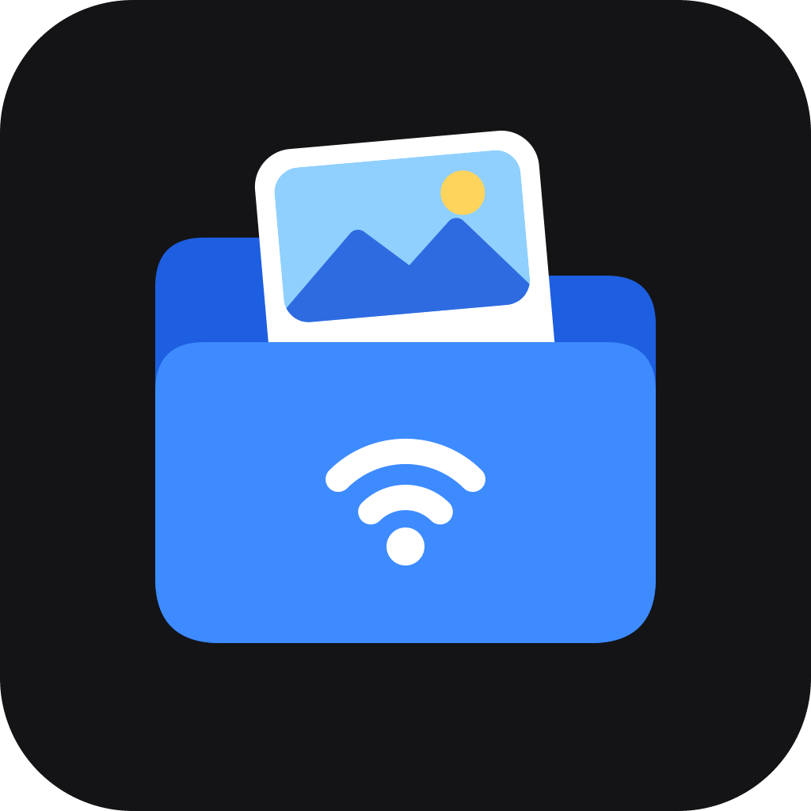

  

Media Preview Server is an Eagle plugin that turns the Eagle on your Mac or PC into a self-hosted media server.
Start it with one click, then browse your library (**Media Library**) from phones, tablets, and PCs on your local network.

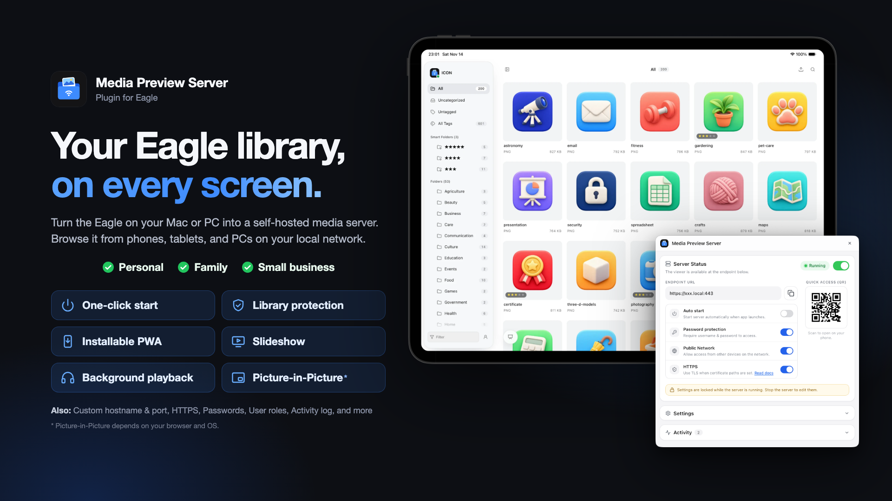

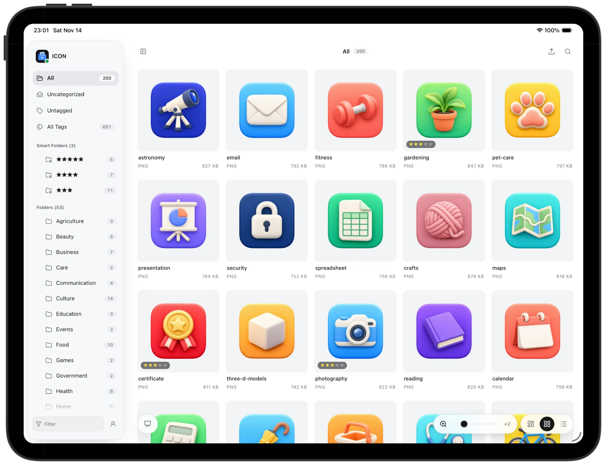
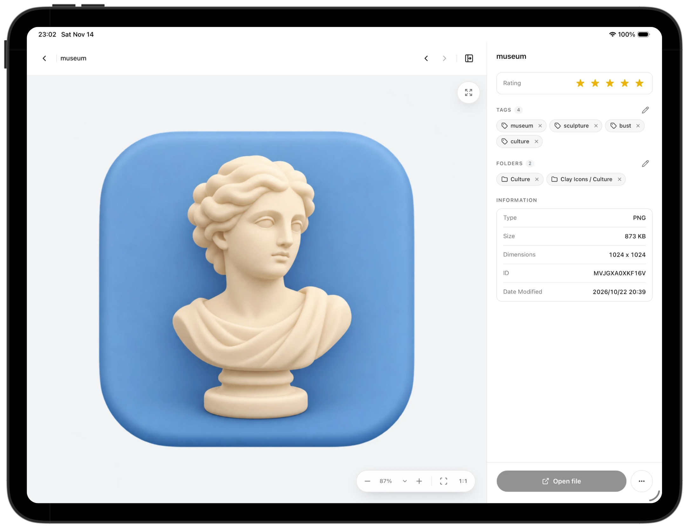
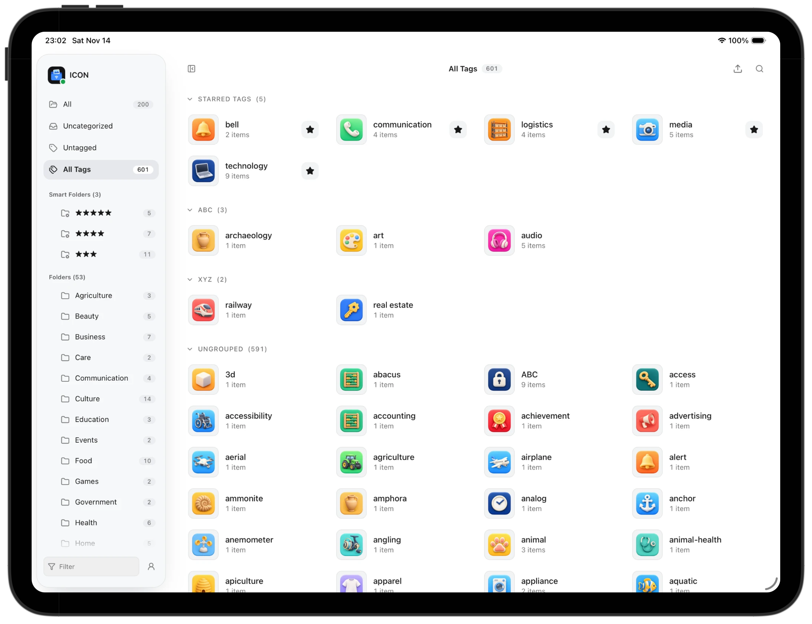
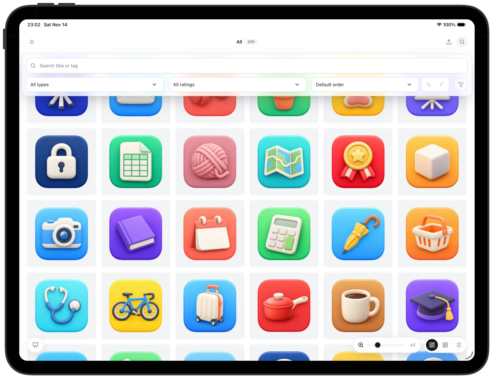
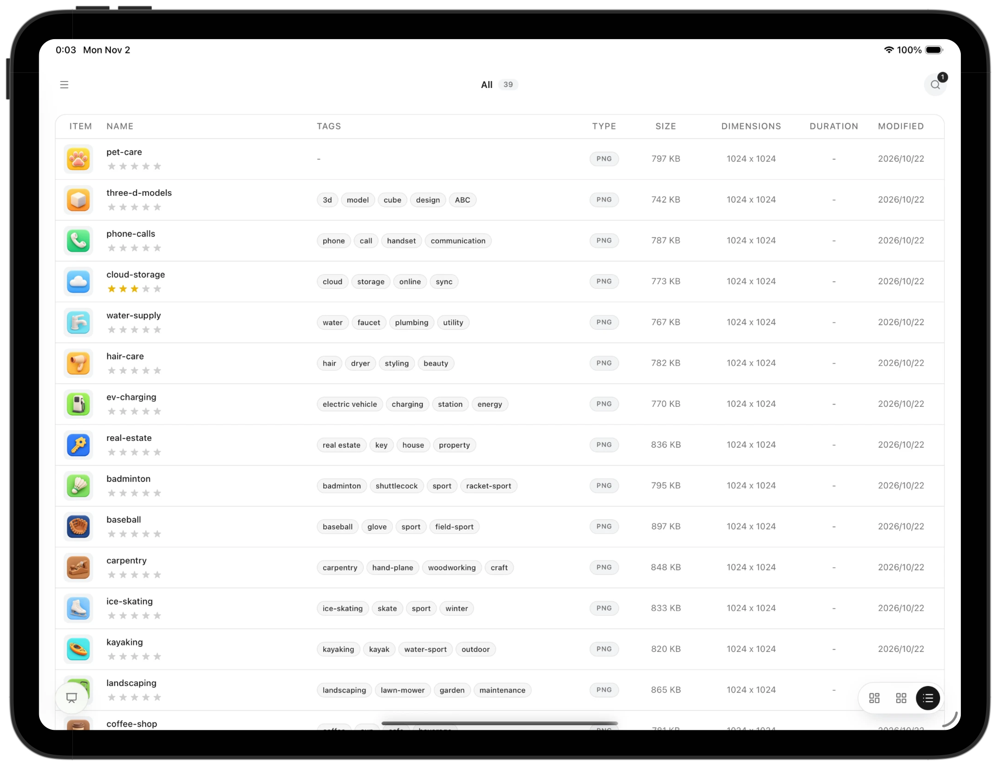

## Features

- One-click local preview server for your Eagle library
- Browse the Media Library from phones, tablets, and other computers on the same LAN
- Endpoint URL and QR code for quick access, with a customizable hostname and port
- Installable PWA (**Media Library**) with a cached application shell
- Background audio and video playback with OS media controls
- Picture-in-Picture for video previews on supported browsers

Optional:

- Auto start: start the server automatically when Eagle launches.
- Password protection: require a username and password to access the viewer.
- Public Network: allow access from other devices on the network.
- HTTPS: use TLS when certificate paths are set.
- Multiple users with Viewer, Editor, Editor + Upload, and Admin roles.
- File Upload (experimental): add files to the library open in Eagle, for Admin and Editor + Upload users.
- Library protection: share only the Eagle libraries you select.

<strong>PWA Installation</strong>

The browser viewer can be installed from a supported desktop or mobile browser. Service workers require a secure context, so use HTTPS when opening the viewer from another device on your LAN. Loopback addresses such as `localhost` are also treated as secure by browsers.

The PWA caches only the application shell. Eagle API responses and library media are intentionally excluded from the service-worker cache, so browsing library content still requires a connection to the running plugin server.

On iPhone and iPad, open the viewer in Safari, tap **Share → Add to Home Screen**, and keep **Open as Web App** turned on.

  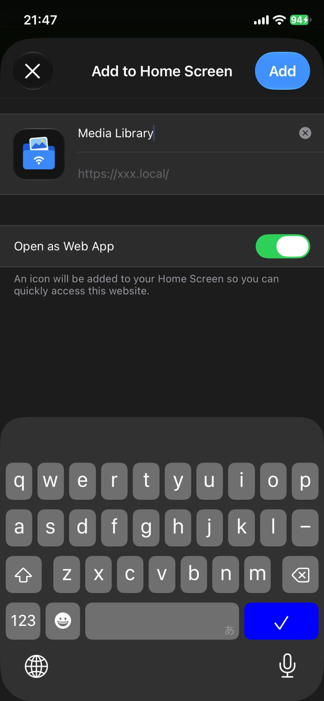
  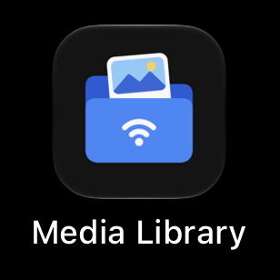

<strong>Slideshow</strong>

Slideshows start muted on all devices. To hear video or audio, use the speaker button in the bottom playback bar to turn sound on during playback.

<strong>Video Picture-in-Picture</strong>

Use the **Picture-in-Picture** button in video controls. It appears when the browser supports the loaded video. Closing the preview or switching items closes PiP.

- **Chrome automatic PiP:** Requires HTTPS, audible playback, and permission for the site. “Can ask” also depends on playback history. [Requirements](https://developer.chrome.com/blog/automatic-picture-in-picture-media-playback).
- **macOS Safari:** Enable **Video Viewer** from Safari's Page Menu for automatic PiP when switching tabs. [Details](https://webkit.org/blog/15865/webkit-features-in-safari-18-0/#viewer).
- **Mobile:** Support varies by browser and OS. If an installed web app lacks PiP, try opening the URL in Safari.

<strong>File Upload (experimental)</strong>

> [!NOTE]
> This feature is experimental and may change. For regular imports, adding files directly in Eagle is recommended.

Admin and Editor + Upload users can upload with the upload button at the top right of the viewer.

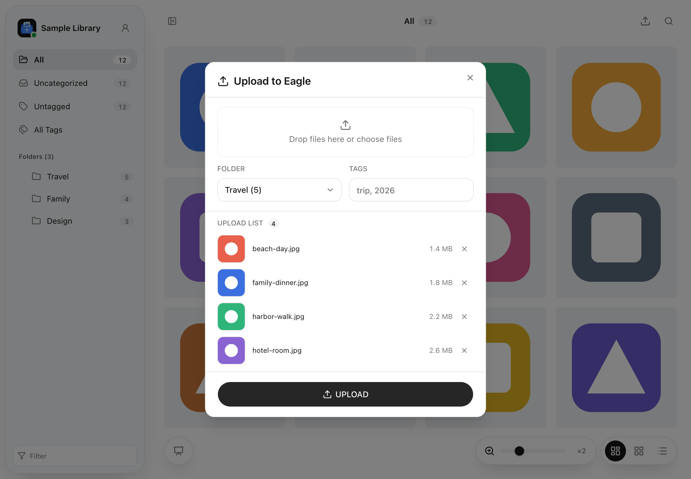

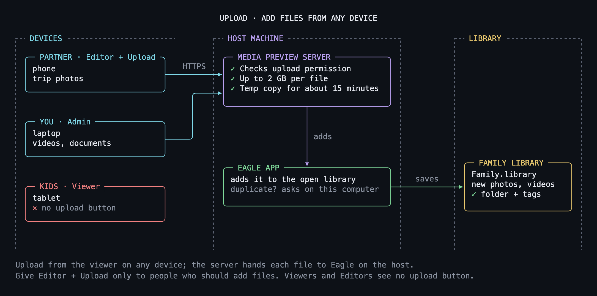

Uploads add files to the library open in Eagle, up to 2 GB each by default, with an optional folder and tags. A copy stays in this computer's temp folder for about 15 minutes, then the running server removes it. If the server stops first, the copy is removed after it starts again.

The panel has no setting for the upload limits. To change them, stop the server and edit `~/.eagle-media-preview-server/settings.json`: `uploadMaxSizeMB` is the size limit per file (default `2048`), and `uploadTimeoutMinutes` is the time allowed to receive one file (default `60`). Raise the timeout along with a larger size limit.

The viewer can show **Success** before a file is really in the library. If Eagle already has the same file, it opens its **Duplicate File Alert** on this computer, and the file isn't added until someone chooses **Use existing file** or **Keep both** there.

<strong>Settings</strong>

#### Server Status

Start or stop the server, copy the endpoint URL, or scan the QR code to open the viewer on your phone. The quick toggles below the URL control **Auto start**, **Password protection**, **Public Network**, and **HTTPS**.

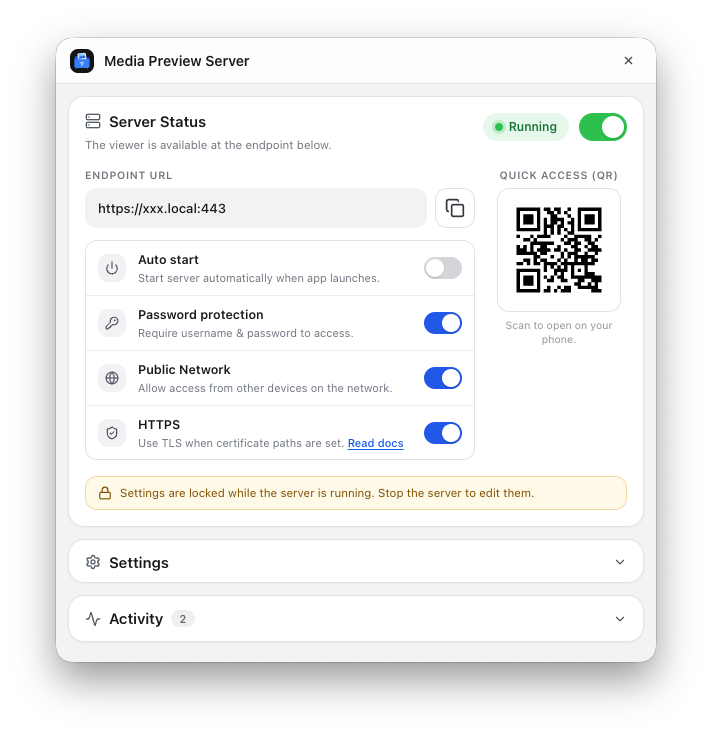

Settings are locked while the server is running. Stop the server to edit them.

#### General

Hostname and port.

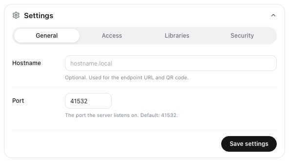

Set **Hostname** to a hostname such as `studio-mac.local`, `windows-pc.local`, or `media-server.lan` (without `http://`, a port, or a path). Stop the server, enter the hostname under **Settings → General**, and save. The endpoint URL, copy/open actions, and QR code use this hostname with the configured HTTP/HTTPS protocol and port. Clear the field to return to the automatic localhost/LAN IP URL.

The saved hostname is explicitly allowed for sign-in and writes; the request Origin must still match the protocol, host, and port. Other custom hostnames remain blocked. This setting does not register DNS or advertise mDNS: configure name resolution separately and enable **Public Network** to connect from other devices. For HTTPS, the certificate must cover the custom hostname and be trusted by each client.

#### Access

Users and sign-in session settings.

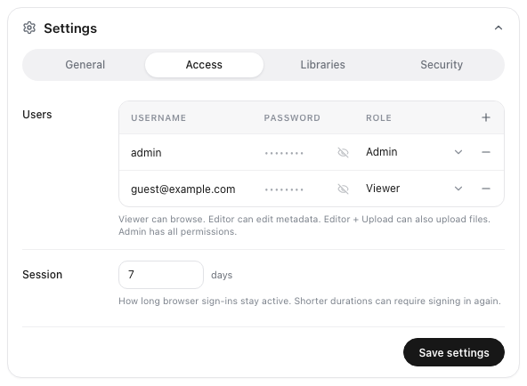

Use this tab to choose which users can sign in to the viewer. To let other devices on the LAN open the viewer, turn on **Public Network** in Server Status. User roles define the available actions:

- Viewer: browse and preview media
- Editor: edit rating, tags, and categories from the preview panel
- Editor + Upload: everything an Editor can do, plus uploading files
- Admin: everything an Editor can do, including uploads, plus:
  - Move items to Eagle's trash and restore them. Files are not permanently deleted.
  - Open every shared library, including libraries limited to selected users

Authentication is optional. When password protection is enabled, browser access uses the built-in login screen and cookie-based sessions. Sessions expire after the configured session duration, 7 days by default.

> [!IMPORTANT]
> Media is stored in the browser's normal cache and may be reused for up to one hour after it is fetched, without asking the server. Signing out, switching accounts, or switching libraries does not immediately remove media that is already cached, even if the account can't open that library. On a shared device, use a private window.

#### Libraries

Choose which Eagle libraries the viewer may serve.

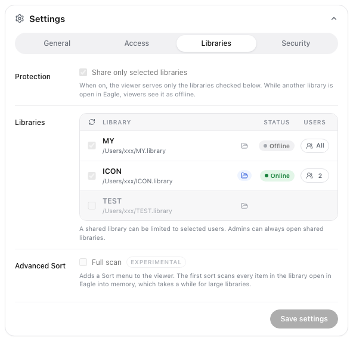

Eagle can only have one library open, and the viewer serves whichever library that is. Turn on **Share only selected libraries**, check the libraries to share, and save. If you open a different library in Eagle, viewers see the "Media Library is offline" page as soon as the viewer opens, before signing in, until a shared library is open again. The list shows the library open in Eagle and Eagle's recent libraries; use the reload icon at the top of the list to refresh it. Checked libraries are saved by path.

The list's status shows **Online** for the shared library viewers can open right now: the server is running and it is the library open in Eagle. Other saved shared libraries show **Offline**, and libraries that aren't shared, or whose sharing isn't saved yet, show nothing.

**Who can open a library.** With **Password protection** on, each shared library can be limited to selected users. The people button at the end of the library's row shows **All** (the default: everyone with an account) or how many users can open it, counting admins; click it, choose **Selected users**, and tick the users who may open the library. Admins can always open every shared library. A user who signs in while a library they may not open is open sees a message saying so, stays signed in, and can connect again once a library they may open is open, or sign in as another user. The check applies to every request, not only at sign-in, so an existing session loses access as soon as Eagle switches to a library that user may not open.

If every selected user is deleted, the library stays limited and only admins can open it (nobody, if there are no admins); it never opens to everyone. Renaming a user in **Access** keeps their libraries. With password protection off, the selections are kept but not applied.

Like other settings, these are locked while the server is running and take effect when the server starts.

**Switching libraries.** Click the folder icon on a library's row and confirm to open that library in Eagle. This also works while the server is running; connected viewers return to the connect screen. Only this panel can switch libraries: viewers can never switch the library open in Eagle.

#### Security

HTTPS/TLS settings.

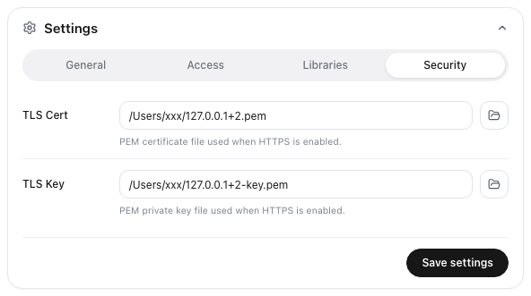

HTTPS protects the login password and session cookie on the network. For local/LAN use, `mkcert` is the recommended way to create a trusted development certificate.

See [HTTPS and mkcert CA Operations](docs/https-mkcert.md) for setup, plugin HTTPS settings, Windows/macOS/iOS/Android CA trust steps, and private-key cautions.

- `TLS Cert`: the certificate file
- `TLS Key`: the matching private key file

#### Activity

See which devices connected and what they did: sign-ins, views, edits, failed requests, and server events. Successful browsing isn't listed. Recent events can be filtered by type and searched by any text they show. Click an address, user, or event to filter by exactly that value.

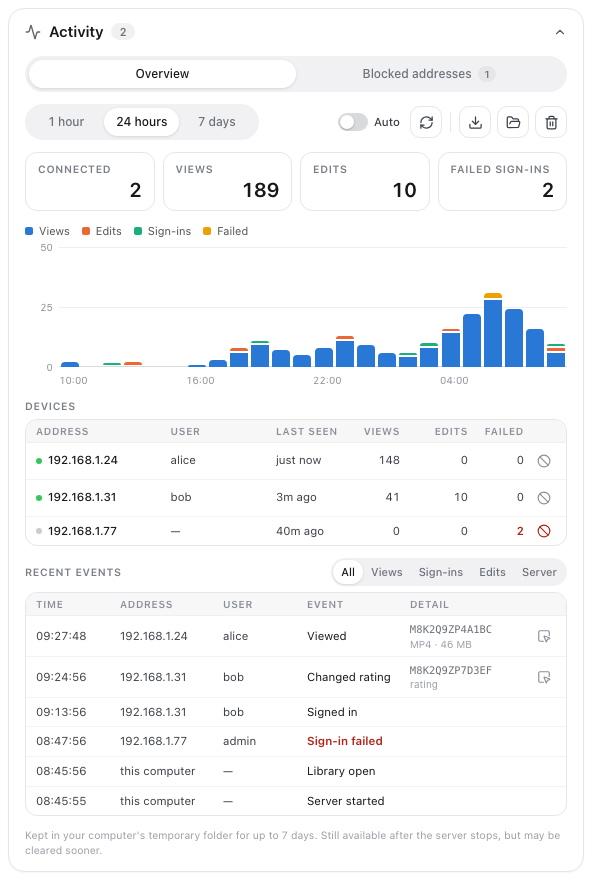

Block a device from its row or by entering an address or CIDR range under **Blocked addresses**. Blocks apply right away, also while the server is running.

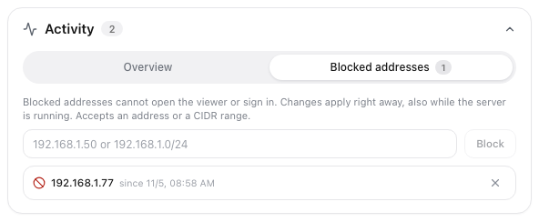

The log is kept in your computer's temporary folder for up to 7 days and can be exported as CSV.

## Use Cases

#### Personal: browse your own library from your laptop and phone

Keep Eagle running on your desk and open the library from your laptop or phone on the home Wi-Fi. Turn on **Public Network** and **Password protection**, and set up **HTTPS** if you want to install the viewer as a PWA.

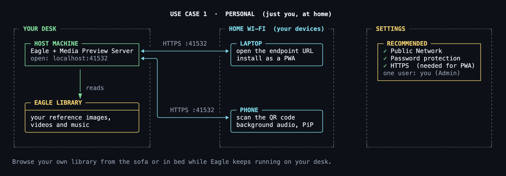

#### Family: a home media library on a NAS

An always-on host machine opens a library stored on the NAS and serves it to the whole family. Give each person their own user and role, and use **Share only selected libraries** so your other libraries stay private.

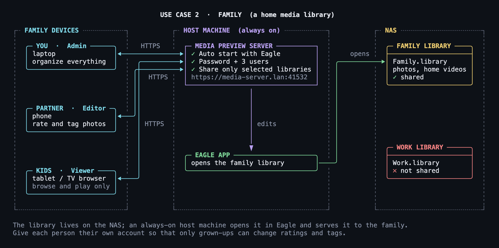

#### Business: a quick share with a teammate

A shares one project library with B for a review, then stops the server. B only needs a browser. Eagle and a copy of the files are not required.

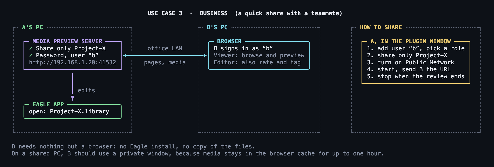

Diagram sources are in [docs/use-cases](docs/use-cases).

## Architecture

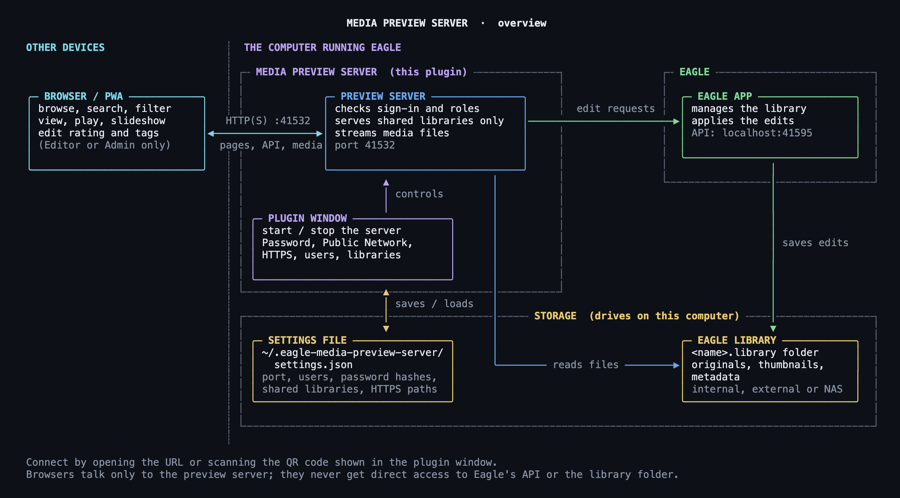

The preview server, plugin window, and settings file come from this plugin, not from Eagle itself; the plugin runs the server inside Eagle. Browsers on other devices talk only to that preview server. They never get direct access to Eagle's own API or the library folder.

For the detailed architecture, access control, and file protection, see [Runtime Model in EAGLE_PLUGIN_SPEC.md](docs/EAGLE_PLUGIN_SPEC.md#runtime-model).

## Details

See [EAGLE_PLUGIN_SPEC.md](docs/EAGLE_PLUGIN_SPEC.md) for plugin behavior, settings, server routes, authentication, and runtime details.

See [DEVELOPMENT.md](docs/DEVELOPMENT.md) for requirements, development, build, and verification.

See [store_description.md](docs/promo/store_description.md) for the Eagle plugin store listing text.

## Future Plans

Planned features and limitations

- Expand support for additional file extensions
- Add AI-related capabilities

#### Limitations

The displayed content depends on the Eagle library opened by the Eagle app running on the server side.

These are planned, but on hold until the Eagle API supports them:

- Sort results by date, rating, name, or size
- Add or remove favorite tags
- Filter by multiple file extensions at once
- Use search filters inside smart folders

## Disclaimer

This plugin is intended for use on a local or trusted LAN, not for public internet access.

The author is not responsible for unintended access, data exposure, or any damage caused by misconfiguration, insecure network settings, weak passwords, disabled authentication, or public exposure of the server.
