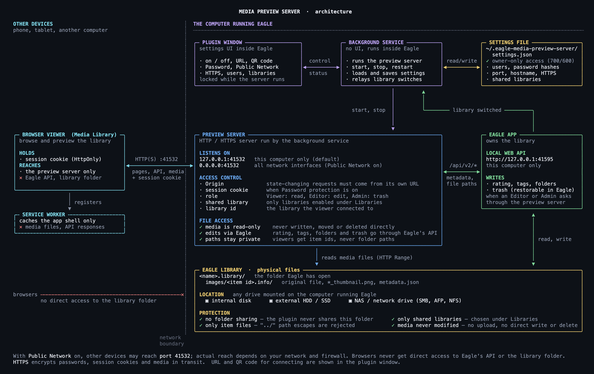

# Eagle | Media Preview Server Spec

## Overview

Eagle | Media Preview Server is an Eagle plugin that starts a local HTTP or HTTPS server on the computer running Eagle, allowing devices on the same LAN to browse media from the Eagle library.

The product has two user-facing surfaces:

- `Server management window`
  - Runs inside Eagle
  - Manages server start, stop, settings, Endpoint URL, and QR code
- `Browser viewer`
  - Opens in a phone, tablet, or another computer's browser
  - Handles library search, filters, tag chips, paged/grid/list/tiles views, and previews

External devices connect to the plugin server, not directly to Eagle's Web API.

## Goals

- Start and stop the media preview server from inside Eagle
- Browse Eagle media from iPhone, iPad, and other computers on the same LAN
- Make access simple through an Endpoint URL and QR code
- Optionally protect access with a viewer login
- Serve images, videos, audio, and text-like files in browser-friendly formats
- Keep server status and settings understandable for non-technical users

## Non-Goals

- Public Internet exposure
- Folder-level or item-level ACLs
- Full Eagle metadata editing beyond rating, tags, and categories
- Persistent request logs or a log viewer screen
- Custom video transcoding or audio transcoding

## Runtime Model


The preview server, plugin window, and settings file are provided by this plugin, not by Eagle itself. Browsers on other devices talk only to the preview server. The preview server reads library media files from disk and sends edits to Eagle's local Web API, which saves them to the library. The plugin window controls the server and saves its settings to `~/.eagle-media-preview-server/settings.json`.



- Plugin window, background service, and preview server are parts of this plugin; they run inside Eagle on the computer running Eagle. The Eagle app, its local Web API, and the library are Eagle's own
- The background service starts, stops, and restarts the preview server, loads and saves `~/.eagle-media-preview-server/settings.json`, and relays Eagle's library-switch events
- The preview server calls Eagle's Web API (`/api/v2/*`) for metadata and file paths, and reads originals and thumbnails from `<name>.library/images/<item id>.info/` directly
- The library folder may be on an internal disk, an external HDD / SSD, or a NAS / network drive mounted on the computer running Eagle; the plugin never shares the folder itself
- Media files are read-only to the preview server; rating, tags, folders, and trash changes go through Eagle's API

`npm run diagram` prints these diagrams in the terminal (`overview` or `architecture` prints one). The images above are its colored output on a dark background, captured by `npm run diagram:images`. The routes are listed under HTTP/HTTPS Server.

Defaults and how to change them:

| Setting | Default | Changed by |
| --- | --- | --- |
| Viewer server host | `127.0.0.1` | **Public Network** toggle: on listens on `0.0.0.0`, off on `127.0.0.1` |
| Viewer server port | `41532` | **Settings → General → Port** (1–65535) |
| Eagle API URL | `http://localhost:41595` | Not a user setting; the `EAGLE_BASE_URL` environment variable of the Eagle process overrides it for development |
| Password protection | disabled | **Password** toggle, with users under **Settings → Access** |
| HTTPS | disabled | **HTTPS** toggle, with TLS paths under **Settings → Security** |
| Public Network | disabled | **Public Network** toggle |
| Auto start | disabled | **Auto start** toggle |

All values are saved to `~/.eagle-media-preview-server/settings.json`. Fields under **Settings** are locked while the server runs and take effect at the next start. The toggles in Server Status stay available while it runs, and a change to Password, Public Network, or HTTPS restarts the running server.

## Codebase Model

The source is managed as a TypeScript / React / Vite / Tailwind CSS / Vitest project.

- `plugin/app.tsx`
  - React management window loaded by Eagle
  - Bundled by Vite/esbuild into `dist/plugin/app.js`
- `src/viewer/**/*.tsx`
  - Browser viewer shell and reusable React components
  - Component styling is primarily Tailwind utility classes in the components, with shared structural rules in `src/styles.css`
- `src/viewer/**/*.ts`
  - Viewer state, URL sync, media helpers, formatting, API calls, and controller logic
- `plugin/service/*.cts`
  - Eagle-compatible service runtime sources
  - Compiled by `tsconfig.plugin-service.json` to `dist/.generated/plugin-service/*.cjs` files for Eagle's `require` runtime
- `server/viewerServer.ts`
  - ESM wrapper that reuses the generated plugin service runtime for tests and local imports
- `scripts/diagram.mjs`
  - Prints the overview and architecture diagrams for `npm run diagram`
- `scripts/diagram-images.mjs`
  - Captures those diagrams as dark-mode PNGs in `docs/` for `npm run diagram:images`
- `scripts/frame-ipad.swift`
  - Frames an iPad screenshot with Xcode's iPad Pro 13" bezel for the README screenshots, for `npm run screenshot:frame`

Build output is created under `dist`:

- `dist/manifest.json`
- `dist/plugin/index.html`
- `dist/plugin/app.js`
- `dist/plugin/styles.css`
- `dist/plugin/assets/*`
- `dist/plugin/service/*.cjs`
- `dist/public/index.html`
- `dist/public/app.js`
- `dist/public/viewerApp.js`
- `dist/public/styles.css`
- `dist/public/assets/*`
- `dist/public/favicon.ico`
- `dist/public/manifest.webmanifest`
- `dist/public/service-worker.js`

## Server Management Window

### Responsibilities

- Show the current server state
- Start and stop the server
- Toggle auto-start
- Toggle Public Network access
- Configure the port
- Configure Password protection
- Configure multiple users with Viewer, Editor, and Admin roles
- Choose which Eagle libraries the viewer may serve
- Display and copy the Endpoint URL
- Display the Endpoint URL as a QR code
- Keep settings usable in the fixed-size Eagle window through a collapsible panel and resizable window

### UI Elements

- `Server Status`
  - States: `stopped`, `running`, `error`
  - Shows a busy indicator while start/stop/save actions are in flight
  - Power toggle for start and stop
- `Endpoint URL`
  - Current access URL
  - Copy action
- `Quick Access (QR)`
  - Shows the URL QR code only while the server is running
  - Shows an empty-state icon while the server is stopped
- `Options`
  - Auto start
  - Password protection
  - HTTPS
  - Public Network
- `Settings`
  - Collapsible settings panel
  - Port
  - Hostname (optional hostname for access URLs, QR, and trusted same-origin writes)
  - TLS certificate path
  - TLS key path
  - Users
  - Per-user role and password
  - Session duration
  - Libraries: protection toggle, shared-library checklist, and a Reload libraries button; like other settings, they are locked while the server runs and take effect when it starts
  - The checklist is built on the admin's machine, without the Eagle HTTP API: saved entries, the open library from `eagle.library`, and `libraryHistory` from Eagle's `Settings` file in `eagle.app.getPath("userData")` (only that key is read; libraries that no longer exist are skipped)

### Persisted Settings

```ts
type Settings = {
  settingsVersion: 2;
  authUsers: Array<{
    username: string;
    role: "viewer" | "editor" | "admin";
    passwordHash: string;
  }>;
  autoStart: boolean;
  customDomain: string;
  host: string;
  httpsCertPath: string;
  httpsEnabled: boolean;
  httpsKeyPath: string;
  port: number;
  authEnabled: boolean;
  sessionSecret: string;
  lastServerStatus: "running" | "stopped" | "error";
  libraryProtectionEnabled: boolean;
  sessionDurationDays: number;
  sharedLibraries: Array<{ name: string; path: string }>;
};
```

`libraryProtectionEnabled` defaults to `false`, so the library open in Eagle is shared as before. When it is `true`, the viewer serves only libraries listed in `sharedLibraries`; an empty list shares nothing. Paths are compared after removing trailing separators, case-insensitively on macOS and Windows.

Legacy settings with `basicAuthUser`, `passwordHash`, and `allowMetadataEditing` are read for migration, converted into `authUsers`, and rewritten with `settingsVersion: 2`.

`customDomain` defaults to an empty string for existing settings. A configured hostname is normalized to lowercase ASCII (including IDN conversion), validated, and persisted. It overrides the hostname in the management panel's endpoint URL and QR; the listener host, protocol, and port remain independently configured. Clearing it restores automatic localhost/LAN IP selection. Changes require a server restart to update the trusted hostname. Unsafe requests require an exact Origin match and either localhost, an IP address, or the configured custom domain; no wildcard or implicit `.local` trust is granted. DNS/mDNS registration and TLS certificate issuance are managed outside the plugin.

Settings path:

```text
~/.eagle-media-preview-server/settings.json
```

## Browser Viewer

### Responsibilities

- Connect to the Eagle API
- Display the library name and Eagle version
- Fetch items page by page
- Filter by folder, uncategorized state, extension/type, rating, keyword, and tag chips
- Switch between tiles, grid, and list views
- Preview images, videos, audio, text-like files, PDFs, and unsupported media
- Change rating, tags, and categories from the preview panel when authenticated metadata editing is enabled
- Open the original file in a new tab
- Sync search filters, page, view mode, and preview state into the URL
- Clear viewer state and return to the login screen when an authenticated viewer API request returns `401`
- Show the "Media Library is offline" page on load, before sign-in, when `/api/library-status` reports that the open library is not shared
- Clear viewer state and show the same page when health polling or Connect reports that the open library is not shared
- Clear viewer state and return to the connect screen when Eagle switches to a different library: on a `409 LIBRARY_CHANGED` or a different `X-Library-Id` on a fetch, or, after a pinned media element fails to load, on the id reported by `/api/health`

### Supported Browsing Features

- Keyword search
- Folder filter
- Uncategorized filter
- Extension filter
- Rating filter
- Tag filter chips
- Page size: `30`, `60`, `120`, `240`
- Tiles view
- Grid view
- List view
- Infinite loading in tiles view
- URL history restore

### Preview Behavior

- Images
  - Loads the original file from `/file/:id`
  - Supports fit, actual size, zoom in, and zoom out
  - Supports drag, wheel zoom, and touch pinch
- Videos
  - Playable extensions: `mp4`, `webm`, `mov`, `m4v`
  - Uses native browser controls
  - Preloads metadata
  - Attempts autoplay after opening
- Audio
  - Playable extensions: `mp3`, `wav`, `m4a`, `aac`, `ogg`
  - Uses native browser controls
  - Attempts autoplay after opening
- Text-like files
  - Preview extensions: `txt`, `md`, `js`, `css`, `html`, `json`, `xml`, `csv`, `log`, `ts`, `tsx`, `jsx`, `mjs`, `cjs`, `yml`, `yaml`
  - Fetches the original file from `/file/:id`
  - Displays source content as escaped plain text in a dedicated text preview
- PDF
  - Preview extension: `pdf`
  - Displays the Eagle thumbnail as an image preview
  - The original PDF is still available through the open-file action
- Unsupported timed media
  - Shows the thumbnail and an unsupported-format message

## HTTP/HTTPS Server

### Static Routes — no sign-in

- `GET /`
  - Browser viewer shell
- `GET /assets/*`
  - Viewer assets
- `GET /manifest.webmanifest`, `GET /service-worker.js`, `GET /favicon.ico`
  - PWA manifest, service worker, and icon

### API Routes

Routes are grouped by what a caller needs. Each group lists its requirements:

- `no sign-in`: anyone who can reach the server may call it
- `sign-in`: a valid session cookie, required only when Password protection is on (otherwise `401`)
- `library id`: the id from `/api/connect` or `/api/health`, sent as the `X-Library-Id` header or the `library` query parameter (see Shared Library Protection)
- `role`: the signed-in user's role must allow the change (otherwise `403`)

Routes with a fixed method return `405` with an `Allow` header for unsupported methods.

#### Sign-in — no sign-in

- `GET /api/auth/status`
  - Returns whether authentication is required, whether the current request is authenticated, the current user, viewer permissions, and the configured session max age in seconds
- `POST /api/auth/login`
  - Requires username and password
  - Issues an HttpOnly session cookie: `viewer_session_http` for HTTP and `viewer_session` for HTTPS
  - When authentication is disabled, returns an authenticated response with anonymous read permissions and does not issue a cookie
- `POST /api/auth/logout`
  - Clears viewer session cookies and removes the server-side session token

#### Library status — no sign-in

- `GET /api/library-status`
  - Lets the viewer show the offline page on load, before sign-in
  - Returns only `{ libraryStatus: "shared" | "not_shared" | null }`; never the library name, path, or id
  - Answers `shared` without calling Eagle when library protection is off

#### Connection — sign-in

These routes hand out the library id, so they do not require one.

- `POST /api/connect`
  - Checks the server-configured Eagle API connection and returns app info and the library display name and id
  - The request body is ignored; viewer clients cannot change the Eagle API host, port, or token
  - The library is read again after the body arrives: if it is not shared it returns `503`, and if Eagle switched libraries during the request it returns `409 LIBRARY_CHANGED`, so an unshared library is never named
- `GET /api/health`
  - Checks Eagle app/library health; polled by the viewer; library paths are never returned to clients
  - Returns `libraryStatus` (`shared`, `not_shared`, or `null` when Eagle is unreachable) and, for a shared library, `library: { id, name }`, where `id` is an opaque per-install HMAC of the library path
  - Always answered, even when the open library is not shared

#### Browse — sign-in, library id

- `GET /api/folders`
  - Returns folder list
- `GET /api/smart-folders`
  - Returns smart folder list
- `GET /api/items`
  - Returns item list or search results; `smartFolderId` lists a smart folder's items
- `GET /api/item-types`
  - Returns the file extensions found in the library
- `GET /api/tags`, `GET /api/tag-overview`
  - Return tags, and tags with tag groups and starred tags
- `GET /api/tag-cover`
  - Returns a cover item for a tag; requires `tag`

#### Media — sign-in, library id

Media URLs carry the library id as the `library` query parameter, since media elements cannot send headers. File routes support HTTP Range requests (see Media Streaming).

- `GET|HEAD /api/items/:id/thumb`
  - Serves item thumbnail
- `GET|HEAD /api/items/:id/file`
  - Serves original file
- `GET|HEAD /file/:id`
  - Direct original file access, used by the "Open file" link
- `GET /api/items/:id/url-preview`
  - Returns the URL stored in a web-link (internet shortcut) item

#### Edit — sign-in, library id, role

- `POST /api/items/:id/star` — Editor or Admin
  - Updates rating
- `POST /api/items/:id/metadata` — Editor or Admin
  - Updates tags and folders/categories from the preview panel
- `POST /api/items/:id/trash` — Admin
  - Moves an item to Eagle's trash or restores it; requires `isDeleted` as a boolean

#### Eagle Web API — called by the viewer server only

The viewer server calls Eagle's local Web API at `http://localhost:41595/api/v2/`. Viewer clients never call it.

- `app/info`, `library/info`: Eagle version and the open library
- `item/get`, `item/query`, `item/update`: items, search, and rating, tag, and folder changes
- `folder/get`, `smartFolder/get`: folders and smart folders
- `tag/get`, `tagGroup/get`: tags and tag groups

### Shared Library Protection

- Eagle can only have one library open, and the viewer server serves whichever library that is
- When library protection is on, every `/api/*` route except auth routes and `/api/health`, and every `/file/*` route, first checks the open library against `sharedLibraries`
- A library that is not shared returns `503 { "error": "The library open in Eagle is not shared", "code": "LIBRARY_NOT_SHARED" }` before any library data is read
- If Eagle cannot report the open library, the request fails instead of being served
- Library info is cached for at most 3 seconds; the plugin also clears it on `eagle.onLibraryChanged`
- Authorized `/api/*` and `/file/*` responses carry `X-Library-Id`, the same opaque id as `/api/health`, but only while the open library is shared; the id of an unshared library is never sent, including on a `409` that refuses an answer after a switch
- The sharing check, the id check, and `X-Library-Id` all use one snapshot of the open library. The switch counter is read before that snapshot is taken, so a switch while a request is being admitted returns `409 LIBRARY_CHANGED`
- After Connect, the viewer pins every request to the library it connected to: fetches send the id as the `X-Library-Id` request header, and media URLs (`/file/:id`, `/api/items/:id/thumb|file`) carry it as a `library` query parameter, since media elements cannot send headers. The address bar never contains it
- Every route that reads or changes library data (`/api/*` except auth routes, `/api/library-status`, `/api/connect`, and `/api/health`, plus `/file/:id`) requires the id; without it they return `400 { "error": "A library id is required for library requests", "code": "LIBRARY_REQUIRED" }`. The library is checked before an item id is looked up, so an item id alone never returns a file. The "Open file" link that opens the original in a new tab carries the id too; older bookmarks without it no longer work
- A request whose id differs from the open library returns `409 { "error": "The library open in Eagle has changed", "code": "LIBRARY_CHANGED" }`, and one made while Eagle cannot report the open library returns `502`, in both cases before any library data is read
- The check is repeated within the request, without extra Eagle calls for reads: each request remembers the library it was admitted for and a switch counter bumped by `eagle.onLibraryChanged`. Right before a JSON answer or a media stream is sent, the cached library info and the counter must still match; otherwise the answer is replaced with `409 LIBRARY_CHANGED` and `X-Library-Id` reports the new library
- Writes (rating, tags, categories, trash) re-read the open library from Eagle right after the request body arrives and right before calling Eagle, so holding back the body cannot redirect a write to another library
- A media stream that has already started is sent to the end
- The viewer server never calls Eagle's library switch API

### Media Streaming

- Allows only `GET` and `HEAD`
- Supports HTTP Range requests
- Sends `Content-Disposition: inline`
- Sends `Cache-Control: private, max-age=3600`, so a browser may reuse a media response for up to an hour without asking the server, including after sign-out or a library switch
- Sends `Last-Modified` (the file's modification time) and a weak `ETag` built from the file size and its millisecond modification time
- Answers conditional requests with `304 Not Modified` and no body:
  - `If-None-Match` matches when any listed tag equals the ETag (weak comparison) or is `*`; when present, `If-Modified-Since` is ignored
  - Otherwise `If-Modified-Since` matches when the file has not changed since that date at second precision; an invalid date or one later than the server clock is ignored
  - Conditions are evaluated before `Range`, so a matching conditional range request also gets `304`
  - Sign-in, the library id, and the shared-library checks run before any conditional check, so a `304` is never returned where the full response would be refused
- A range request that carries `If-Range` and does not get `304` from the conditional checks above always gets the whole file with `200`, and its `Range` is ignored even if unsatisfiable. RFC 9110 lets `If-Range` match only a strong validator, and the server has none: the ETag is weak, and `Last-Modified` has second precision, so a file replaced within the same second would still match its date and mix old and new bytes. Range requests without `If-Range`, such as ordinary video seeking, are served as `206`
- Sends `X-Content-Type-Options: nosniff`
- Returns MIME types for common images, videos, audio, PDF, and text files

## Authentication

When password protection is enabled, viewer API routes and media routes require authentication except:

- `/api/auth/status`
- `/api/auth/login`
- `/api/library-status`

Static viewer routes stay available so unauthenticated browsers can load the login screen.

Supported authentication paths:

- `viewer_session_http` or `viewer_session` cookie issued by the login API; cookie and server-side session tokens expire after the configured session duration, 7 days by default
- Browser authentication uses the HttpOnly cookie only; session tokens are not returned in JSON or accepted through `Authorization` headers
- HTTPS mode requires certificate and private key paths, serves the endpoint with `https://`, and adds `Secure` to `viewer_session`
- If a cookie session expires or is rejected, viewer API requests return `401`; the browser viewer treats that as an auth reset and prompts for login again

Roles:

- Viewer: can browse and preview media
- Editor: can browse and update rating, tags, and categories
- Admin: highest available role; includes metadata editing and any admin-only server capabilities exposed by the current UI/API

Password handling:

- Plain text passwords are never persisted
- New passwords are stored as salted PBKDF2-SHA-256 hashes
- Existing legacy SHA-256 hashes are still accepted for migration compatibility

Authorization:

- Browsing is read-only by default
- `POST /api/items/:id/star` and `POST /api/items/:id/metadata` require an Editor or Admin user
- `POST /api/items/:id/trash` requires an Admin user
- The viewer server never calls Eagle's library switch API; switching libraries is only possible from the Eagle app
- Unsafe methods reject mismatched `Origin` or `Referer` headers before API handlers run
- JSON request bodies are capped at 1 MiB; malformed bodies return `400` and oversized bodies return `413`

## Runtime State

Server states:

- `stopped`
- `starting`
- `running`
- `stopping`
- `error`

Main status fields:

- `host`
- `port`
- `boundAddress`
- `boundPort`
- `lastError`
- `activeSessions`
- `requestCount`

`requestCount` is an in-memory runtime counter and is not persisted as a log.

## User Flows

### First-time setup

1. Open the server management window in Eagle
2. Enable `Public Network`
3. If needed, add Viewer, Editor, or Admin users and enable `Password protection`
4. Confirm the Port setting
5. Start the server with the power toggle
6. Open the Endpoint URL or scan the QR code from a phone
7. Browse the Eagle library in the browser viewer

### Daily use

1. If Auto start is enabled, the server starts when Eagle launches
2. Confirm `Running` in the server management window
3. Open the browser viewer from the Endpoint URL or QR code
4. Search, filter, and preview media

### Protected access

1. Add at least one user with a password
2. Assign Viewer, Editor, or Admin roles
3. Enable Password protection
4. To protect credentials and sessions on the wire, enter TLS certificate/key paths and enable HTTPS
5. If the server is already running, settings changes that affect binding, protocol, TLS paths, or auth restart it automatically
6. External browser access requires authentication

## Build and Verification

Development command:

```sh
npm install
npm run dev
```

`npm run dev` starts the Vite development server for the React surfaces. It is for local UI development and does not replace the Eagle plugin runtime build.

Build and verification commands:

```sh
npm run typecheck
npm run build
npm test
npm run verify
```

`npm run build` compiles the plugin service `.cts` files into `dist/.generated/plugin-service` before Vite builds and packages the React surfaces. The Vite package step also copies `manifest.json`, plugin icons/assets, public assets, favicon, the PWA manifest and service worker, generated service `.cjs` files, and CSS into `dist`.

Generated `dist/.generated/plugin-service/*.cjs` files and `dist` output are build artifacts.

`npm run verify` runs TypeScript checks, the production build, and Vitest.

Diagram commands:

```sh
npm run diagram
npm run diagram -- overview
NO_COLOR=1 npm run -s diagram
npm run diagram:images
```

`npm run diagram` prints the overview and architecture diagrams; pass `overview` or `architecture` to print one. Set `NO_COLOR=1` for plain text. It does not need a build.

`npm run diagram:images` captures the colored output as dark-mode PNGs into `docs/architecture_overview.png` and `docs/architecture.png` with headless Chrome. Run it after changing `scripts/diagram.mjs`. Set `CHROME_PATH` when Chrome or Chromium is not in a standard location.

Screenshot command:

```sh
npm run screenshot:frame -- <screenshot> docs/screenshot.png
```

`npm run screenshot:frame` places a landscape iPad Pro 13" screenshot (4:3, such as 2752x2064 from the device or the simulator) inside the iPad bezel and writes a transparent PNG. It needs macOS with Xcode, because the bezel comes from `/Library/Developer/DeviceKit/Chrome/tablet5.devicechrome`. Screenshots with another aspect ratio are refused.

## Implementation Notes

- QR code generation is bundled into the plugin window from the `qrcode-generator` dependency.
- The browser viewer registers its service worker only in production builds. The service worker caches the application shell and excludes `/api/*` and `/file/*` so authenticated API responses and library media are never added to its cache.
- Generated `dist/.generated/plugin-service/*.cjs` files are build artifacts and are not tracked as source.
- Request log UI, diagnostics UI, and shared URL expiration UI are intentionally not part of the current implementation.
