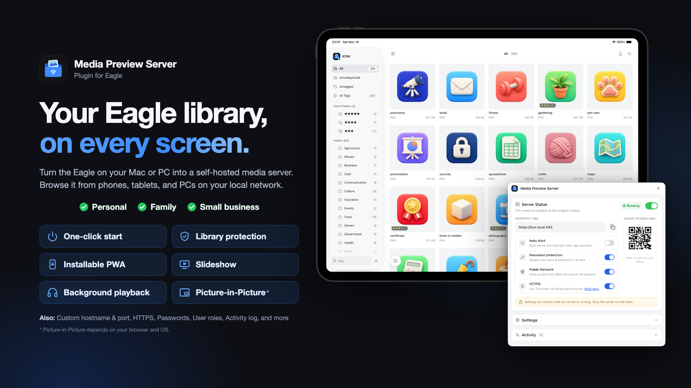
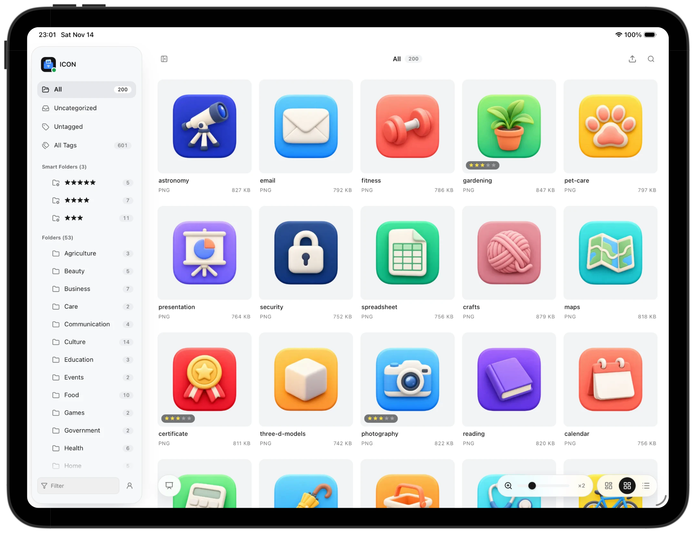
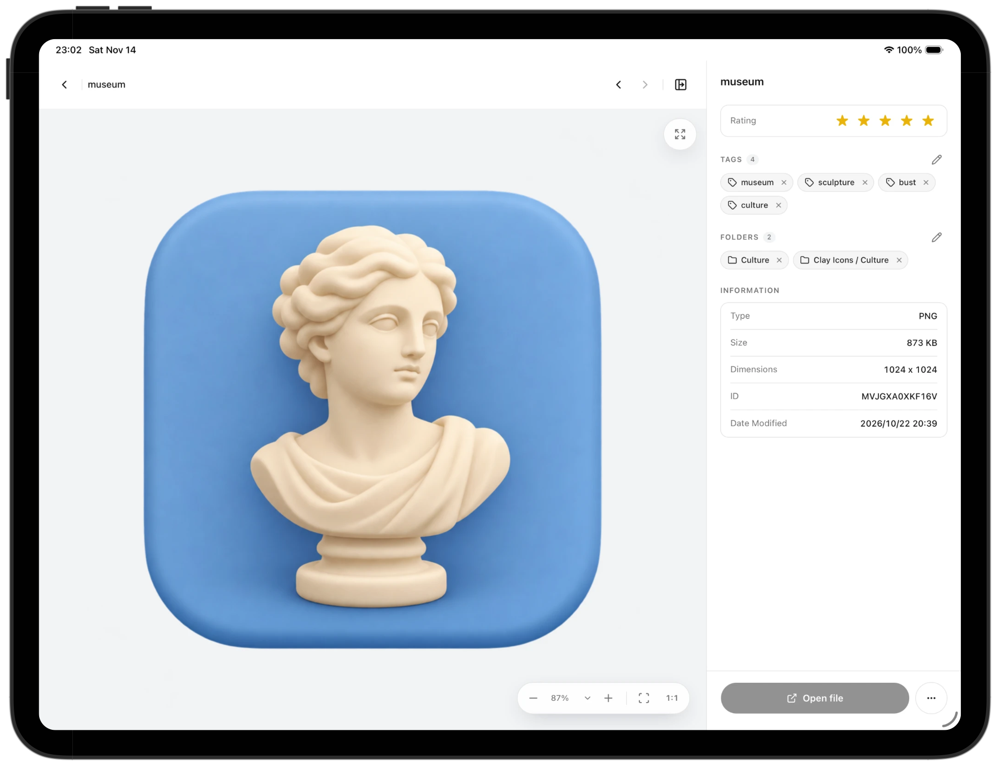
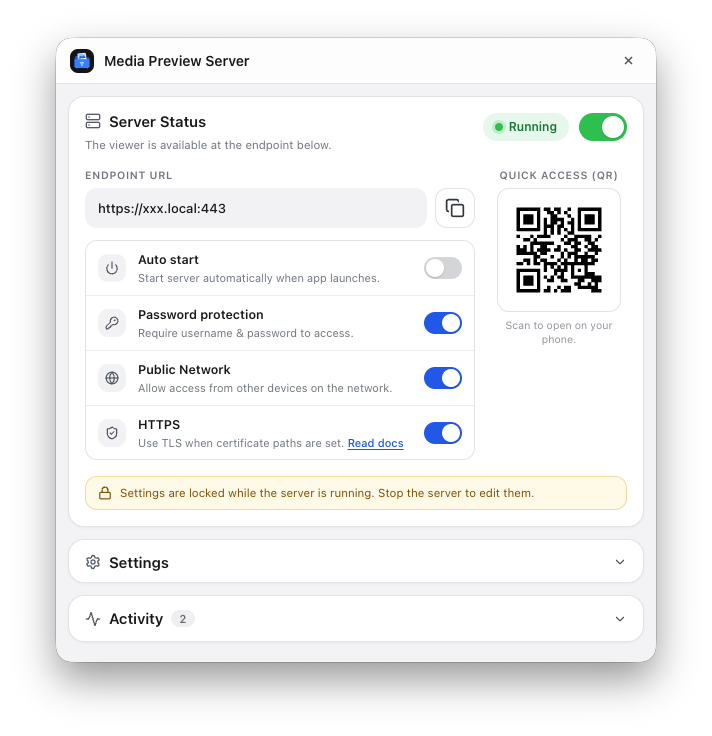

# Eagle Plugin Store Description

## Short description

Browse your Eagle library from phones, tablets, and other computers on your local network.

## Details

Turn the Eagle on your Mac or PC into a self-hosted media server.
Start it with one click, then browse your library from any browser on your local network. Other devices don't need Eagle or a copy of your files.

### Features

- One-click server with an endpoint URL and QR code
- Browse from phones, tablets, and other computers on your LAN
- Slideshow, background playback, and Picture-in-Picture
- Installable as a web app (HTTPS required on other devices)
- Multiple users with Viewer, Editor, Editor + Upload, and Admin roles
- Editors can change ratings, tags, and categories
- File Upload (experimental): add files to the library open in Eagle
- Share only selected libraries, with optional per-user limits
- Optional password protection and HTTPS
- Activity log with address blocking

### Use cases

- Personal: browse your library from your laptop or phone at home
- Family: serve a NAS library, with an account for each person
- Business: share a project library with a teammate for a quick review

### Getting started

1. Open the plugin. To allow other devices, turn on Public Network. Password protection is recommended.
2. Start the server.
3. Scan the QR code or open the endpoint URL on your other device.

### Good to know

- Eagle must be running on the host computer.
- Viewers see the library currently open in Eagle.
- Library content requires a connection to the running server.
- If an uploaded file is already in the library, Eagle shows its duplicate dialog on the host computer, and someone has to answer it there.

### Disclaimer

This plugin is intended for a local or trusted LAN, not for public internet access.

The author is not responsible for unintended access, data exposure, or any damage caused by misconfiguration, insecure network settings, weak passwords, disabled authentication, or public exposure of the server.

### Documentation

Full settings guide and HTTPS setup: https://github.com/tuki0918/eagle-media-preview-server
